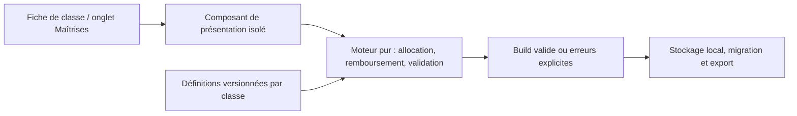

# Audit fonctionnel des simulateurs de classes — 25 octobre 2026

## Conclusion

Les parcours ordinaires d’allocation fonctionnent : budget de 20 points, rangs, paliers et coût des synergies. Les deux outils restent toutefois des **planificateurs de talents de conception**, pas des simulateurs de combat. Le chargement de sauvegardes, la navigation et plusieurs interactions nécessitent des corrections avant une intégration complète au Codex.

L’intégration native est possible sans nouveau framework ni serveur. Il faut isoler un moteur commun, conserver les définitions propres aux classes et migrer les sauvegardes ; insérer directement les scripts actuels dans le Codex créerait des collisions de fonctions globales.

## Périmètre et preuve

- Commit public audité : `21387e04d2a0ad0e069d60660e4e459ff4b16cde`.
- Les deux HTML téléchargés depuis le domaine public ont été comparés octet par octet au checkout : identiques, HTTP 200.
- Sources : [simulateur général](../../simulateur/classes/index.html), [Rempart V8](../../simulateur/rempart/index.html), liens depuis les fiches de classe et données publiques du Codex.
- Chromium, contextes neufs et données synthétiques, copie HTTP locale isolée. Aucune sauvegarde réelle de joueur lue ou modifiée ; aucune modification de production.
- **31 contrôles : 14 réussis, 17 échecs**, regroupés ci-dessous en causes fonctionnelles. Un contrôle agrégé parcourt les 24 classes ; un échec ne désigne donc pas nécessairement un défaut distinct.
- [Résultats détaillés](simulators-2026-10-25-results.json) et [script reproductible](../../scripts/audit_class_simulators.py).
- Les noms des dix compétences de chacune des 24 classes concordent avec les fiches publiques, après normalisation des suffixes de classe et apostrophes. Cette concordance ne valide aucun équilibrage.
- Contrôles de mise en page en 1440 × 1000 et 390 × 844 : aucun débordement horizontal au chargement. Firefox, Safari, appareils physiques et lecteur d’écran non testés.

Le script retourne volontairement **1 lorsque des contrats échouent** : il ne faut pas présenter ce résultat comme une suite réussie ni l’ajouter à la CI obligatoire avant correction.

## Deux modèles différents

| Élément | Général, 24 classes | Rempart V8 |
| --- | --- | --- |
| Voies du Rempart | Forteresse, Assaut, Vigilance | Bastion, Fracture, Vigie |
| Talents | 24 par classe, générés à partir des 10 compétences et d’un modèle de rôle | 24 talents nommés, descriptions spécifiques |
| Origine des voies | Quatre modèles : Tank, DPS mêlée, DPS distance, Heal | Définition spécifique au Rempart |
| Synergies | Trois combinaisons génériques | Six synergies nommées, deux par paire de voies |
| Sauvegarde | Automatique après modification | Boutons Sauvegarder / Charger |
| Clé locale | `ashenfall-all-masteries-v1-<classe>` | `ashenfall-rempart-v8` |
| Équipement et barres | Absents | Sélecteur d’arme, barres de 10/20/30 emplacements et raccourcis |
| Calcul de combat | Aucun | Aucun |

Les « 72 arbres / 576 talents » du général sont des déclinaisons de quatre modèles, et non 72 spécialisations écrites individuellement. Les améliorations de rang et effets hybrides sont descriptifs, sans calcul de dégâts, soins, résistance, recharge ou ressources. Cette limite est signalée dans l’interface comme conception non canonique.

Il n’existe pas de migration entre les deux versions du Rempart : on peut donc avoir deux builds indépendants et incompatibles pour la même classe. Le V8 contient aussi des libellés de conception à rapprocher de l’arsenal actuel : par exemple son talent « Défi Renforcé » parle d’interruption, alors que l’arsenal public distingue la provocation du Défi et l’interruption du Coup de Heurt. Cela exige une décision de conception, pas une harmonisation automatique de mécaniques.

## Prérequis réellement implémentés

| Règle | État constaté |
| --- | --- |
| Budget total | `somme des rangs + 2 × synergies`, plafond de 20. Testé dans les deux moteurs ; dépassement par les commandes ordinaires bloqué. |
| Talents | Trois voies de huit talents ; deux rangs maximum par les boutons de l’interface. |
| Paliers | 0 / 5 / 10 points. Le passage du deuxième palier entre 4 et 5 points fonctionne. |
| Remboursement | Refus si un talent ou une synergie détenue perd ses prérequis ; état préservé. Retour explicatif absent dans le général. |
| Rang 2 | Deux choix apparaissent ; le choix est supprimé en revenant au rang 1. Testé dans les deux outils. |
| Synergie | Au moins 5 points dans chacune des deux voies, coût de 2 points. Testé dans les deux outils, y compris remboursement protégé du Rempart. |
| Choix non sélectionné au rang 2 | Aucun contrôle de build « incomplet » ; l’état est accepté sans choisir A ou B. À traiter comme brouillon ou à préciser selon le produit souhaité. |
| Équipement | Aucune règle d’éligibilité liée à l’arme dans le V8. Passer du bouclier à une arme à deux mains ne change ni les capacités ni l’accès aux talents de blocage. |
| Niveau du personnage | Pas de niveau ni de progression du budget par niveau. |
| Ressources / PvE / PvP | Pas de simulation d’endurance, mana, stabilité, GCD, recharge, cible, dégâts ou soins. |
| Disponibilité des actions | Le V8 propose tous les talents débloqués dans la barre, sans catégorie actif/passif. « Pieds de Pierre » devient par exemple une action proposée. |

### Ambiguïté à trancher : points de palier

Les validateurs soustraient le rang du talent considéré mais comptent les **autres points de toute la voie**, y compris les talents supérieurs. Après un remboursement, deux talents supérieurs de rang 1 restent valides avec 9 points dans les paliers inférieurs et 11 points dans la voie : ils contribuent mutuellement au seuil de 10.

Ce n’est pas classé comme violation du libellé actuel, qui parle de points dans la voie. Il faut décider si le seuil doit plutôt compter exclusivement les paliers inférieurs avant de modifier le moteur.

## Défauts reproduits et corrections recommandées

### F1 — Validation des sauvegardes du général — priorité haute

`init()` fusionne directement le JSON sauvegardé et ne valide pas l’ensemble. `valid()` ne contrôle pas non plus toutes les bornes, types et identifiants.

Résultats reproduits : rang −4 → **24 points libres sur 20** ; rang 0,5 accepté ; rang 3 accepté ; rang texte → **NaN** ; talent du palier supérieur sans fondations affiché malgré `valid() === false` ; identifiant inconnu compté comme dépense.

Correction : schéma explicite, identifiants autorisés, rangs entiers 0–2, choix A/B liés au rang 2, synergies uniques et connues, budget et dépendances vérifiés **avant installation de l’état**. Une récupération doit préserver une copie de la sauvegarde et expliquer les éléments ignorés ou refusés.

### F2 — Chargement Rempart non transactionnel — priorité haute

Une sauvegarde avec 30 emplacements `null` passe le seul test de longueur. Le chargement remplace déjà les rangs et les emplacements, puis `render()` échoue sur `ability`. L’erreur est affichée, mais l’état partiellement installé reste actif ; le clic suivant échoue à nouveau.

Correction : construire et valider un candidat complet (rangs, choix, synergies, slots, arme, nombre de slots) avant de remplacer l’état courant. En cas d’échec, aucun champ de l’état ni du formulaire ne doit changer.

### F3 — Raccourci interpolé comme HTML — priorité haute avant import/partage

Dans le V8, `slots[i].key` est concaténé dans `innerHTML`. Une chaîne HTML saisie dans le champ de raccourci s’exécute comme HTML ; un marqueur JavaScript bénin a été reproduit localement.

**Portée constatée : saisie locale dans un navigateur isolé. Aucun scénario d’exploitation à distance, accès à des données de joueur ou transfert de données n’a été démontré.**

Correction : `textContent` / création de nœuds, validation et normalisation du raccourci. Appliquer les mêmes protections aux futures sauvegardes importées ou partagées.

### F4 — Sauvegardes Rempart encore trop permissives — priorité moyenne

Le clamp 0–2 conserve les fractions : un rang 0,5 est accepté. `owned` filtre les indices mais pas les doublons : une même synergie chargée deux fois est acceptée et facturée deux fois.

Correction : entiers stricts, ensemble unique d’identifiants et validation des choix et emplacements. Ne pas confondre normalisation partielle et validation complète.

### F5 — Échec de sauvegarde non géré — priorité moyenne

Dans le général, une exception de `localStorage.setItem` interrompt l’action avant `render()`. Après un clic, le modèle possède 19 points libres, mais l’écran affiche toujours 20. Le bouton Sauvegarder du V8 ne protège pas non plus son écriture.

Correction : rendre la modification cohérente en mémoire, intercepter l’échec de persistance et présenter une alerte non bloquante avec export de secours. La disponibilité de stockage local est un prérequis à la persistance, pas au fonctionnement du planificateur en mémoire.

### F6 — Classe sélectionnée et URL divergentes — priorité moyenne

Depuis `?classe=arcaniste`, sélectionner Duelliste produit `?classe=arcaniste#duelliste`. Au rechargement, la query reprend priorité : retour à Arcaniste. Modifier ensuite le hash seul ne met pas la classe à jour, faute de gestion de `hashchange`.

Correction : un routeur et une source de vérité ; conserver la compatibilité d’entrée avec les anciennes URL mais toujours réécrire une URL canonique après changement.

### F7 — Focus clavier perdu — priorité moyenne

Dans les deux outils, activer « + » au clavier remplace les arbres par `innerHTML`. Le bouton focalisé est détruit et le focus revient sur `BODY` : on ne peut pas continuer naturellement avec Espace. Le général fournit aussi des boutons « + » / « − » sans nom accessible indiquant le talent, contrairement au V8.

Correction : mise à jour ciblée du nœud, ou restauration explicite du focus sur le même talent et la même action ; noms accessibles et annonces de budget / refus via `aria-live`.

### F8 — Affectation à un emplacement devenu invisible — priorité moyenne

Dans le V8, sélectionner le 30e emplacement puis réduire la barre à 10 laisse `selected = 29`. Attribuer une action ou un raccourci modifie alors l’emplacement invisible ; la barre visible ne change pas.

Correction : borner la sélection au nombre d’emplacements affichés ; préciser la conservation des slots masqués, signaler les raccourcis en conflit et les actions qui ne sont plus disponibles après remboursement.

### F9 — Refus silencieux de remboursement — priorité ergonomique

Dans le général, « − » reste activé mais ne produit aucun retour quand le remboursement invaliderait un talent ou une synergie. Le modèle est correctement restauré, mais le joueur ne sait pas pourquoi rien ne se passe.

Correction : expliquer la dépendance bloquante au bouton ou lors de l’action, et l’annoncer de manière accessible.

## Intégration native recommandée

Remplacer le lien de l’onglet **Arbre** par un véritable onglet **Maîtrises** dans la fiche de classe. Conserver le peuple, les quatre classes, la recherche et la navigation du Codex autour du composant. Le Rempart doit employer ce même moteur avec sa propre définition, plutôt que rester une seconde application indépendante.

Éviter de copier les HTML/scripts dans la page : `render` est déjà utilisé dans le Codex et les deux simulateurs ; `getClass` existe dans le Codex et le général. Une insertion brute change leurs signatures et leurs effets. Une iframe peut isoler provisoirement les scripts mais conserve deux applications et ne résout ni la duplication des règles, ni les sauvegardes incompatibles.



### Organisation technique

- **Définitions publiques versionnées** : IDs stables de talents et compétences, rangs, types actif/passif, prérequis, choix, synergies et éventuelles contraintes d’équipement. Marquer les propositions comme telles ; ne pas fabriquer d’amélioration chiffrée.
- **Moteur sans DOM** : `validateBuild`, `canAllocate`, `allocate`, `refund`, `choose`, `toggleSynergy`. Une action produit un nouvel état complet validé ou une raison de refus ; pas de mutation partielle.
- **Composant natif** : rendu dans le panneau de la classe, résumé du budget visible, explication des paliers manquants, retour clavier conservé. Réutiliser la charte du Codex. Pas de framework imposé.
- **Persistance isolée** : schéma de build et version des définitions, gestion du stockage indisponible, lecture des anciennes clés et migration contrôlée. Sauvegarder l’original si la correspondance V8 / général n’est pas exacte ; ne pas effacer un build incompatible.
- **Navigation** : route canonique du type `#/rempart/maitrises` et adaptation explicite du routeur actuel. Compatibilité avec `?classe=` et les liens historiques, sans query/hash contradictoires.

### Ordre de réalisation

1. Corriger les invariants et la persistance, puis faire réussir les contrôles actuellement en échec. Définir quelle version du Rempart fait référence, comment compter les points de palier et ce qu’impose l’équipement.
2. Extraire le moteur et les définitions ; intégrer le composant dans les deux présentations actuelles des fiches (Rempart et autres classes), avec migration et tests des 24 classes.
3. Ajouter comparaison de builds, annuler/rétablir et import/export ou partage par URL, en ne transportant que des identifiants / rangs / choix validés. Les prérequis et l’échappement doivent être corrigés avant ces échanges.
4. Si une vraie simulation de combat est souhaitée, définir séparément les règles approuvées de puissance, mitigation, ressources, cadence, GCD, recharges, cibles et PvP/PvE ; les descriptions actuelles ne suffisent pas à calculer un DPS fiable.

## Reproduction

Depuis la racine du dépôt, servir uniquement une copie publique des deux simulateurs :

```sh
mkdir -p /tmp/ashenfall-simulator-audit/site/simulateur
cp -R simulateur/classes simulateur/rempart /tmp/ashenfall-simulator-audit/site/simulateur/
python3 -m http.server 8020 --bind 127.0.0.1 --directory /tmp/ashenfall-simulator-audit/site
```

Dans un autre terminal (Playwright et Chromium disponibles) :

```sh
PYTHONDONTWRITEBYTECODE=1 python3 scripts/audit_class_simulators.py
```

Le résultat attendu de cet audit sur le commit indiqué est 14 contrôles réussis / 17 en échec, avec sortie 1. Les contrôles doivent être actualisés lors de la correction, sans conserver artificiellement les défauts. Aucun script d’audit ne doit être exécuté sur les données réelles d’un utilisateur.
